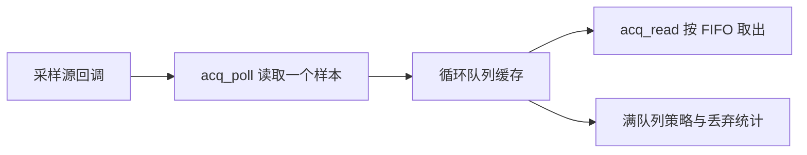

# Stack & Queue Acquisition Lab

**使用 C11 实现的循环队列数据采集模块，以及栈、队列与表达式求值的学习工程。**

项目把“读取一个采样值、写入缓冲区、按顺序处理数据”连成完整流程，重点演示循环队列如何复用空间、如何处理生产速度超过消费速度的情况，以及如何用自动测试验证这些行为。

当前提供控制台程序和确定性的模拟采样源，适合数据结构课程实训、C 多文件工程练习，以及为真实传感器读取函数准备缓冲接口。

## 功能概览

| 模块 | 已实现功能 |
|---|---|
| 数据采集 | 采样源回调、启动/停止/重启、停止后读取缓存、采样与丢弃统计、源错误恢复 |
| 循环队列 | FIFO、下标回绕、牺牲单元法与计数器法、拒绝新数据或覆盖最旧数据 |
| 顺序栈 | 初始化、销毁、push/pop/peek、空满检查 |
| 链栈 | 头插压栈、头删弹栈、按需分配和释放结点 |
| 链式队列 | 队尾插入、队头删除、空队列与最后结点处理 |
| 栈应用 | 三类括号匹配、双栈四则表达式求值 |
| 自动测试 | 33 组行为用例、独立参考模型、项目内存分配审计 |
| 性能实验 | 相同操作序列下对比五种实现，单独预热并记录五轮正式测量 |

## 快速开始

### 1. 准备环境

- Windows，配备 Windows PowerShell 5.1 或 PowerShell 7。
- MinGW-w64 GCC，且 `gcc` 已加入 `PATH`；完整静态检查还需要支持 `-fanalyzer`。
- 通过 Git 克隆时需要 Git；也可下载 ZIP 后解压。

当前实现已在 **MinGW-w64 GCC 16.2.0、Windows PowerShell 5.1** 环境完成验收。项目使用 C11 和系统接口，不需要下载第三方 C 测试框架。现有运行脚本面向 Windows。

构建脚本要求工程位于**非 C 盘**，并将编译产物及临时文件放在工程的 `build/` 中。以下以 `D:\code` 为例，路径可以替换成自己的非 C 盘目录。

### 2. 获取、编译并运行

在 PowerShell 中执行：

```powershell
New-Item -ItemType Directory -Path D:\code -Force | Out-Null
Set-Location D:\code
git clone https://github.com/luck-CMYK/stack-queue-acquisition-lab.git
Set-Location stack-queue-acquisition-lab

# 确认编译器可用
gcc --version

# 编译控制台程序及性能实验程序
powershell -NoProfile -ExecutionPolicy Bypass -File scripts/build.ps1

# 运行数据采集演示
.\build\lab.exe --acquisition
```

使用 PowerShell 7 时，可将脚本命令开头的 `powershell` 换成 `pwsh`。仓库提供源码，`lab.exe` 和 `benchmark.exe` 在编译后生成，不随仓库分发。

### 3. 查看采集结果

模拟源依次产生 `100` 到 `107`，缓冲区有效容量为 `4`，满时覆盖最旧样本。停止采样后，程序按 FIFO 读取缓存：

```text
数据采集演示：模拟传感器产生100至107，有效缓冲4格，满时覆盖最旧样本。
停止采样后FIFO读取： 104 105 106 107
统计：采样=8，读取=4，丢弃=4，源错误=0，待读=0
```

这说明缓冲区保留了最近四个样本，先到达的样本先读取，四个被覆盖的旧样本计入丢弃数量。

## 其他运行方式

在工程根目录执行下列命令：

| 命令 | 用途 |
|---|---|
| `.\build\lab.exe --acquisition` | 只运行数据采集演示 |
| `.\build\lab.exe --demo` | 运行采集、队列、栈、括号匹配与求值演示 |
| `.\build\lab.exe` | 完整演示后进入表达式交互；输入 `q` 或 `quit` 退出 |
| `.\build\lab.exe --eval "-(2+3)*4+10/2"` | 计算表达式，结果为 `-15` |
| `.\build\lab.exe --brackets "{[()]}"` | 检查括号是否匹配 |
| `.\运行演示.cmd` | 自动检查是否需要编译，然后启动交互程序 |

也可以双击根目录的 `运行演示.cmd`。表达式参数请使用引号，避免括号、乘号等被终端解释。

表达式支持十进制整数、小数、科学计数法、`+ - * /`、圆括号和一元正负号；使用 `double` 运算，所以 `1/2` 的结果为 `0.5`。输入上限为 4096 字节，非法语法、除零和非有限数值会返回错误。括号匹配另外支持 `[]`、`{}`。

## 数据采集如何工作



一次 `acq_poll` 最多读取一个样本。采样周期由调用方的循环或定时器决定，模块本身不创建后台线程。初始化后处于停止状态；`acq_stop` 只停止新采样，已有样本仍可读取。

### 两种队列方案

| 方案 | 判空 | 判满 | 物理数组长度为 cap 时的有效容量 |
|---|---|---|---:|
| `Q_SPARE_SLOT` | `front == rear` | `(rear + 1) % cap == front` | `cap - 1` |
| `Q_COUNTED` | `size == 0` | `size == cap` | `cap` |

`front` 指向下一个读取位置，`rear` 指向下一个写入位置。两者移动时都取模，从而复用已经出队的空间。

底层 `q_init_mode` 接收**物理数组长度**；采集模块 `acq_init` 接收**有效样本容量**，会自动换算物理长度。因此，两种采集模式都可以用相同的有效容量进行测试和对比。

### 满队列策略与状态

| 策略 | 缓冲区满时的处理 | `acq_poll` 返回值 |
|---|---|---|
| `ACQ_REJECT_NEW` | 保留已有样本，丢弃本次新采样值 | `ACQ_BUFFER_FULL` |
| `ACQ_DROP_OLDEST` | 淘汰最旧样本，再存入新采样值 | `ACQ_OK` |

实时曲线通常关心最近数据，可以选择覆盖最旧样本；需要保留完整数据时，应记录满队列事件并增加背压、持久化等处理，不能仅依赖有限缓存。

| 状态 | 含义 |
|---|---|
| `ACQ_OK` | 采样入队或读取成功 |
| `ACQ_ERROR` | 参数非法或对象未正确初始化 |
| `ACQ_STOPPED` | 未启动或已停止，此时不会调用采样源 |
| `ACQ_SOURCE_ERROR` | 采样源失败；已有缓存保留，可继续重试 |
| `ACQ_BUFFER_FULL` | 拒绝策略下丢弃了新样本 |
| `ACQ_EMPTY` | 没有待处理样本，读取输出参数保持不变 |

`acq_get_stats` 提供四个计数：`sampled` 为成功从源读取的数量，包含随后被拒绝的新值；`consumed` 为成功交给消费者的数量；`dropped` 包含拒绝的新值或淘汰的旧值；`source_errors` 单独记录读取失败。正常计数范围内满足：

```text
sampled = consumed + dropped + acq_pending(...)
```

## 作为模块使用

核心接口声明位于 [app/acquisition.h](app/acquisition.h)。下面是一个可独立编译的最小示例，仍使用模拟源；接入传感器时替换 `read_sample` 的实现即可。

```c
#include "app/acquisition.h"
#include <stdio.h>

static int read_sample(void *context, int *value) {
    int *next = context;
    *value = (*next)++;
    return 0; /* 成功时写入一个整数并返回0，源失败时返回非0 */
}

int main(void) {
    Acquisition collector;
    int next = 100;
    if (acq_init(&collector, 4, Q_COUNTED, ACQ_DROP_OLDEST,
                 read_sample, &next) != 0) return 1;

    int failed = acq_start(&collector) != 0;
    for (int i = 0; i < 8 && !failed; ++i) {
        if (acq_poll(&collector) != ACQ_OK) failed = 1;
    }
    acq_stop(&collector);

    int value;
    while (acq_read(&collector, &value) == ACQ_OK) {
        printf("%d ", value);
    }
    putchar('\n');
    acq_destroy(&collector);
    return failed ? 1 : 0;
}
```

完成前面的工程编译后，将示例保存为 `build/acquisition_example.c`，在工程根目录执行：

```powershell
gcc -std=c11 -Wall -Wextra -Wpedantic -Werror -I. app/acquisition.c ds/cqueue.c build/acquisition_example.c -o build/acquisition_example.exe
.\build\acquisition_example.exe
```

预期输出 `104 105 106 107`。对象使用完后调用 `acq_destroy`；重新初始化仍持有缓冲区的对象前，也应先销毁旧对象。所有模块均遵循调用方持有结构体、销毁函数释放内部存储的约定。

## 运行测试

```powershell
# O0行为测试及项目分配审计
powershell -NoProfile -ExecutionPolicy Bypass -File scripts/test.ps1

# O2下运行同一组测试
powershell -NoProfile -ExecutionPolicy Bypass -File scripts/test.ps1 -Release

# 完整验收：两种优化等级、GCC静态分析、命令行与交互入口
powershell -NoProfile -ExecutionPolicy Bypass -File scripts/verify.ps1
```

测试失败会输出失败条件并返回非零退出码，可供脚本自动判断；测试不依赖人工观察结果。

| 范围 | 行为测试组数 | 主要覆盖 |
|---|---:|---|
| 循环队列 | 8 | FIFO、空满、绕环、两种方案、覆盖策略、10万次参考模型验证 |
| 顺序栈 | 5 | LIFO、peek不修改栈、空满、10万次参考模型验证 |
| 链栈 | 3 | 压弹、非空销毁、5万次参考模型验证 |
| 链式队列 | 3 | 最后结点删除、非空销毁、5万次参考模型验证 |
| 表达式与括号 | 6 | 优先级、一元符号、错误输入、数值范围、长度和深度边界 |
| 数据采集 | 8 | 启停、FIFO、溢出、源错误恢复、统计、四种配置各10万步验证 |
| **合计** | **33** | 每组可能包含多个输入及大量操作 |

2026-11-05 本地验收中，O0/O2各33组通过，8个生产编译单元通过严格警告和GCC `-fanalyzer` 检查。测试审计的六个进程结束时，项目未释放分配块数均为0。审计覆盖已执行的项目 `malloc/free` 路径，不能替代ASan或证明所有内存不足和越界情况均不存在。

测试会在本地生成 `docs/evidence/` 日志与验证结果；该目录由 `.gitignore` 忽略，不是仓库缺失的前置依赖。

## 性能实验

```powershell
powershell -NoProfile -ExecutionPolicy Bypass -File scripts/benchmark.ps1
```

实验对比两种循环队列、顺序栈、链栈和链式队列。每种实现使用相同的有效容量和预生成操作序列；分别测试逐次插入/移除和64个一批的场景。每轮插入10万个值并移除10万个值，共20万次API调用，单独预热后正式测量5轮。

生成的 `docs/bench.md`、原始CSV和环境JSON保留在本地。计时使用Windows高精度QPC，结果校验使用64位累加值；初始化、销毁和输出不计时，链式结构操作内的分配释放计时。队列FIFO与栈LIFO语义不同，这里的耗时对比不能作为互相替换的依据。

如安装了 `mingw32-make`，也可使用 `mingw32-make`、`mingw32-make test`、`mingw32-make verify`、`mingw32-make bench`。

## 代码结构

```text
app/
  acquisition.h/.c   采集模块与采样源接口
  expression.h/.c    括号匹配、表达式求值
  main.c             控制台入口与模拟采样源
ds/
  cqueue.h/.c        循环队列
  seqstack.h/.c      顺序栈
  liststack.h/.c     链栈
  listqueue.h/.c     链式队列
test/                六个测试程序、断言辅助和分配审计
bench/               统一性能实验程序
scripts/             编译、测试、验收、实验入口
Makefile             MinGW Make入口
```

## 常见问题

- **提示找不到 `gcc`**：确认已安装MinGW-w64 GCC，将其 `bin` 目录加入PATH，再打开新的终端执行 `gcc --version`。
- **找不到 `build/lab.exe`**：先在工程根目录执行 `scripts/build.ps1`。GitHub上的C源码需要先编译。
- **提示 `Use a non-C drive workspace`**：将项目放到D盘等非C盘路径，重新编译。
- **完整验收不支持 `-fanalyzer`**：使用支持该选项的GCC；普通构建和单元测试也可分别执行。当前验收使用GCC16.2.0。
- **双击窗口立即关闭或需要查看错误**：从PowerShell运行编译命令，或使用带暂停的 `运行演示.cmd`。
- **想连接真实硬件**：按回调约定接入串口、ADC或其他数据源；具体协议、驱动、采样时钟及设备故障处理由接入方实现。

## 适用范围

当前采集模块接收整数样本，用于单线程或同一事件循环。真实硬件联调、GUI刷新、跨线程或中断并发尚未验证；多线程使用时需另行提供同步。模拟演示中的“采样”不是物理传感器实测。

遇到问题时，欢迎在仓库提交Issue，并附操作系统、GCC版本、执行命令、完整错误信息和最小复现输入。
